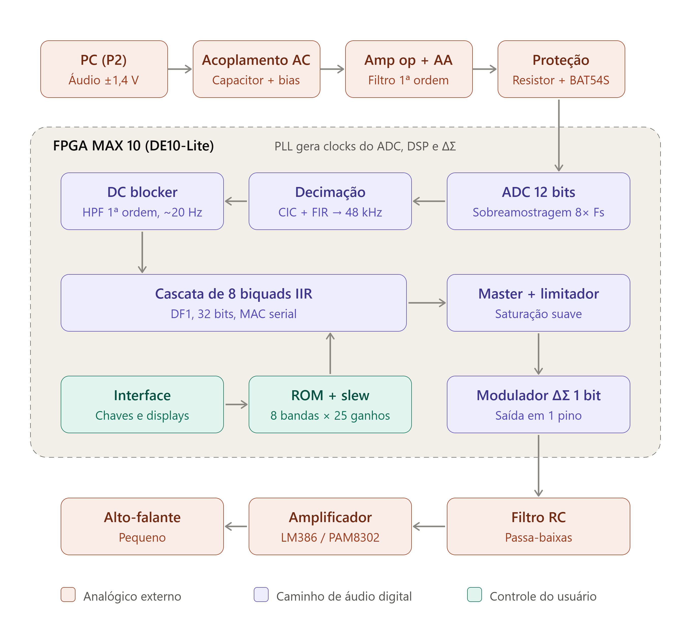

# Equalizador Paramétrico Multibanda

Projeto de um equalizador de áudio digital em tempo real implementado em uma FPGA Intel MAX 10 (10M50) da placa DE10-Lite.

O sistema recebe o áudio analógico da saída P2 de um computador, realiza a conversão e o processamento digital em ponto fixo e devolve o sinal para um alto-falante. O projeto permite ajustar graves, médios e agudos conforme a preferência do usuário ou as características de alto-falantes pequenos, que normalmente têm dificuldade em reproduzir frequências graves.

## Diagrama em blocos



## Funcionalidades

- Captura de áudio analógico pela entrada P2 do computador.
- Conversão analógico-digital de 12 bits com sobreamostragem de 8 vezes a frequência de amostragem.
- Decimação digital por um filtro CIC seguido de um filtro FIR, obtendo processamento em 48 kHz.
- Equalização em oito bandas:
  - 1 filtro low-shelf;
  - 6 filtros peaking;
  - 1 filtro high-shelf.
- Ganhos ajustáveis em passos de 1 dB entre -12 dB e +12 dB por banda.
- Ajuste de ganho master e limitador de saída.
- Processamento por cascata de biquads IIR em Direct Form I.
- Coeficientes de 32 bits e estados ampliados para o processamento em ponto fixo.
- Coeficientes armazenados em ROM, com transição suave (*slew*) para reduzir estalos durante as mudanças.
- DC blocker na entrada para remover componentes contínuas.
- Saturação na saída para proteção do sinal processado.
- Reconstrução do áudio por modulador delta-sigma de 1 bit.
- Controle pela placa, por meio de chaves e botões, com indicação em LEDs e displays de 7 segmentos.
- Interface UART opcional para controle externo.

## Aplicação

Este projeto resolve o problema da alteração da resposta em frequência de um alto-falante em tempo real sem depender de software executado em um computador ou processador geral.

Entre suas aplicações estão o reforço de graves, o ajuste de médias e agudos, a compensação das limitações de alto-falantes pequenos e a demonstração prática de conceitos de processamento digital de sinais em hardware reconfigurável.

O DSP é integrado a conversão A/D, filtragem IIR em ponto fixo, arquitetura MAC serial e conversão D/A por delta-sigma. Como resultado, trata-se de uma solução de baixo custo com latência não perceptível para uso em tempo real.

## Arquitetura de processamento

O caminho de sinal é composto pelas seguintes etapas:

1. **Entrada analógica:** acoplamento AC da saída P2 do computador.
2. **Adaptação do sinal:** amplificador operacional com polarização e filtro anti-aliasing de primeira ordem.
3. **Proteção:** resistor e clamp com BAT54 para limitar tensões indevidas.
4. **Conversão A/D:** ADC interno de 12 bits do MAX 10 com sobreamostragem.
5. **Decimação:** filtro CIC e filtro FIR para reduzir a taxa de amostragem para 48 kHz.
6. **Bloqueio de DC:** remoção da componente contínua.
7. **Equalização:** cascata de oito biquads IIR em Direct Form I.
8. **Ganho e limitação:** ajuste de ganho master, saturação suave e proteção contra clipping.
9. **Conversão D/A:** modulador delta-sigma de 1 bit com saída em um único pino.
10. **Saída analógica:** filtro RC passa-baixas, amplificador de áudio e alto-falante.

## Periféricos utilizados

### FPGA e conversão

- Intel MAX 10 10M50, presente na placa DE10-Lite.
- Modular ADC IP com PLL para a geração dos clocks do conversor.
- PLL para os clocks de processamento do DSP e do modulador delta-sigma.
- Memórias M9K para armazenamento de coeficientes e estados.
- Multiplicadores embarcados na FPGA.

### Interface de usuário

- Chaves da placa para seleção e ajuste.
- Botões da placa para incremento, decremento e confirmação.
- LEDs para indicação de estados.
- Displays de 7 segmentos para apresentação dos parâmetros.
- UART opcional para controle externo.

### Circuito analógico

- Entrada P2 ou saída de áudio do computador.
- Capacitor e bias de acoplamento AC.
- Amplificador operacional TL072, NE5532 ou LM358.
- Fonte apropriada para polarização e alimentação dos componentes.
- Filtro anti-aliasing de primeira ordem.
- Clamp de proteção com resistor e diodo BAT54.
- Filtro RC passa-baixas na saída.
- Amplificador LM386 ou PAM8302.
- Alto-falante pequeno.

## Fluxo do sinal

```text
Computador (P2)
  -> acoplamento AC e polarização
  -> amp op / filtro anti-aliasing
  -> proteção
  -> ADC interno de 12 bits
  -> sobreamostragem e decimação CIC + FIR
  -> DC blocker
  -> cascata de 8 biquads IIR
  -> ganho master e limitador
  -> modulador delta-sigma de 1 bit
  -> filtro RC passa-baixas
  -> amplificador de áudio
  -> alto-falante
```

## Organização esperada do projeto

Com a evolução da implementação, a documentação pode ser complementada com os módulos HDL, arquivos de configuração da placa, tabelas de coeficientes e scripts de geração ou validação dos filtros. Os principais componentes do sistema são:

- Controle de interface e estado;
- gerador ou integração do clock;
- aquisição pelo ADC;
- decimação CIC/FIR;
- núcleo do equalizador IIR;
- interface para coeficientes ROM e transição suave;
- ganho master e limitador;
- modulador delta-sigma;
- blocos de saída e proteção.
